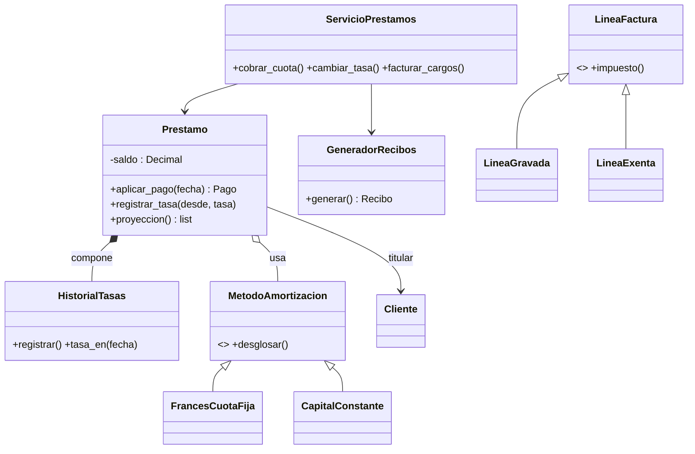

# Sistema de facturación y préstamos con tasa variable

Proyecto de cierre de la **Unidad 4 · Programación Orientada a Objetos** (Universidad CETEC de México · LC627).
Integra **clases, encapsulamiento, herencia, polimorfismo, composición y principios SOLID** en un
caso real: un préstamo cuya **tasa de interés cambia en el tiempo** y que emite un **recibo por cada
cuota** usando la tasa vigente en la fecha de vencimiento.

> Todo el dinero se maneja con `Decimal` (nunca `float`). El tratamiento tributario de las facturas
> (IVA 13 %) es **didáctico**; en un sistema real se parametriza según la ley vigente.

## Cómo ejecutarlo

```bash
python -m venv .venv
source .venv/bin/activate          # Windows: .venv\Scripts\activate
pip install -r requirements.txt

python main.py                      # demostración: préstamo, cambio de tasa, recibos, mora, factura
python -m pytest                    # 45+ pruebas
python ejemplos/ejecutar_todos.py   # ejemplos correcto/incorrecto de cada principio
ruff check . && ruff format --check .
```

## Estructura

```
src/prestamos/
  dinero.py          Decimal, redondeo comercial, formato de moneda
  excepciones.py     Jerarquía de errores (herencia correcta)
  fechas.py          sumar_meses()
  tasas.py           HistorialTasas: qué tasa regía en cada fecha        (composición)
  amortizacion.py    MetodoAmortizacion (ABC) → FrancesCuotaFija, CapitalConstante  (estrategia)
  clientes.py        Cliente
  prestamo.py        Prestamo, Pago, PoliticaMora, LineaProyeccion      (encapsulamiento)
  recibos.py         Recibo, GeneradorRecibos, SecuenciaNumeracion
  facturas.py        Factura, LineaFactura → LineaGravada / LineaExenta  (polimorfismo)
  formatos.py        Protocol + registro @formato_recibo: txt, json, csv (OCP/ISP)
  almacenes.py       Protocol RepositorioPrestamos / AlmacenDocumentos   (DIP)
  servicio.py        ServicioPrestamos: orquesta con dependencias inyectadas
main.py              «Raíz de composición»: aquí se eligen las piezas concretas
ejemplos/            7 ejemplos ❌ incorrecto / ✅ correcto (tema 4.9 y SOLID)
tests/               pytest
```

## Dónde se ve cada concepto

| Concepto | Dónde |
|---|---|
| **Encapsulamiento** | `Prestamo._saldo` solo cambia con `aplicar_pago()`; `HistorialTasas.tramos()` devuelve una copia inmutable |
| **Herencia (bien usada)** | `ErrorDominio → …Error`; `LineaFactura → LineaGravada / LineaExenta` |
| **Polimorfismo** | `MetodoAmortizacion.desglosar()`, `LineaFactura.impuesto()`, `formatear()` |
| **Composición** | `Prestamo` *tiene un* `HistorialTasas` (nace y muere con él) y *tiene un* `MetodoAmortizacion` |
| **S** — Responsabilidad única | `Prestamo` calcula · `GeneradorRecibos` arma · `formatos` presenta · `almacenes` guarda |
| **O** — Abierto/Cerrado | Nuevo formato = nueva clase con `@formato_recibo("html")`; nuevo método = nueva subclase |
| **L** — Sustitución de Liskov | Todos los métodos de amortización liquidan el préstamo (prueba parametrizada) |
| **I** — Segregación de interfaces | `Numeracion`, `FormateadorRecibo`, `AlmacenDocumentos`: contratos de 1–2 miembros |
| **D** — Inversión de dependencias | `ServicioPrestamos` recibe sus dependencias por el constructor; las pruebas usan memoria |

## Cómo se calcula una cuota con tasa cambiante

1. El préstamo guarda un **historial de tramos** `(desde, tasa_anual)`.
2. La cuota *n* vence en `desembolso + n meses`. La tasa aplicada es la **vigente en esa fecha de vencimiento** (no la de la fecha en que se pague).
3. Sistema francés **recalculado** con la tasa vigente y las cuotas que faltan: `cuota = saldo · r / (1 − (1 + r)^−k)` con `r = tasa_anual / 1200`.
4. Si se paga con más de 5 días de atraso se cobra mora: `cuota · 24 % / 360 · días`.
5. El **recibo** muestra tasa aplicada, intereses, capital, mora, total, saldo nuevo y marca si la tasa **cambió** respecto al recibo anterior.



## Retos para el estudiante (actividad integradora)

1. Implementa `RepositorioJSON` (persistencia en archivo) respetando el contrato `RepositorioPrestamos`.
2. Agrega el método `SoloIntereses` y un formato de recibo `html` **sin modificar** ninguna clase existente.
3. Agrega una `PoliticaMora` distinta (tasa por tramos) y una prueba que demuestre que el resto no cambió.
4. Crea una interfaz de consola (menú) que use únicamente `ServicioPrestamos`.

## Publicarlo en GitHub

```bash
git remote add origin https://github.com/<tu-usuario>/sistema-facturacion-prestamos.git
git branch -M main
git push -u origin main
```
